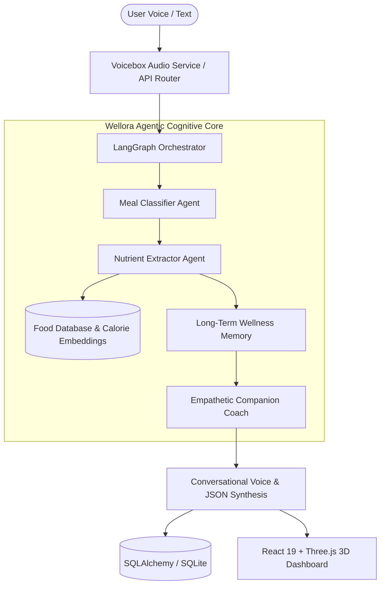

<p align="center">
  <h1 align="center">🌿 Wellora</h1>
  <p align="center">
    <strong>Voice-Enabled Multi-Agent AI Companion for Holistic Health, Nutrition & Lifestyle Tracking</strong>
  </p>
</p>

<p align="center">
  <a href="#overview">Overview</a> •
  <a href="#key-features">Features</a> •
  <a href="#agentic-architecture">Architecture</a> •
  <a href="#tech-stack">Tech Stack</a> •
  <a href="#data-models">Data Schema</a> •
  <a href="#getting-started">Getting Started</a> •
  <a href="#api-reference">API Reference</a>
</p>

<p align="center">
  
  
  
  
  
  
  
</p>

---

## 📖 Overview

**Wellora** is a clinical-grade, voice-first intelligent health companion engineered to bridge the gap between conversational AI and rigorous nutritional science. Built on an asynchronous multi-agent architecture orchestrated by **LangGraph** and **FastAPI**, Wellora enables users to log dietary intake naturally through voice or text, automatically deconstructing complex meals into granular macronutrients and caloric metrics in real time.

Combined with an immersive **React 19 + Three.js (React Three Fiber)** visual dashboard, Wellora delivers real-time wellness feedback, continuous lifestyle coaching, adaptive hydration logs, and long-term metabolic health insights.

---

## ✨ Key Features

- **🎙️ Zero-Friction Voice Logging & TTS**: Conversational voice interface backed by low-latency STT and high-fidelity text-to-speech audio synthesis (`VoiceboxService`).
- **🧠 Autonomous Multi-Agent Nutrition Pipeline**: Orchestrated by LangGraph with dedicated specialist agents:
  - **Meal Classifier**: Dissects multi-component meals, portion sizes, and preparation methods.
  - **Nutrient Extractor**: Queries clinical food databases to compute precise calories, proteins, carbohydrates, fats, and glycemic impacts.
  - **Empathetic Companion Agent**: Delivers motivational guidance, lifestyle suggestions, and habits feedback tuned to user cognitive styles.
  - **Persistent Wellness Memory**: Remembers past dietary restrictions, allergies, and user metabolic targets.
- **📊 3D Interactive Wellness Universe**: Powered by **Three.js** and **React Three Fiber**, presenting bodily wellness metrics, caloric balances, and timeline progressions through procedural visual shaders.
- **⚡ Offline-First Macro Database**: Built-in indexed nutritional database (`food-calorie-data.csv`) providing millisecond lookup speeds without third-party API dependencies.
- **💧 Holistic Lifestyle Telemetry**: Integrated logging for meals, water intake, sleep quality, stress indices, and daily vitality summaries.
- **🔒 Private by Design**: Self-hosted local model capability via **LangChain-Ollama** and embedded SQLite/SQLAlchemy for zero data exfiltration.

---

## 🏛️ Multi-Agent Architecture



### Specialized Agents

| Agent | Responsibility |
| :--- | :--- |
| **`Orchestrator`** | LangGraph state coordinator directing conversational intent between clinical extraction and empathetic dialogue. |
| **`Classifier`** | Parses natural language (e.g. *"I had a bowl of quinoa with grilled chicken and tahini dressing"*) into structured food items and portion weights. |
| **`Extractor`** | Cross-references parsed food items against calibrated nutritional matrices to compute macros. |
| **`Companion`** | Contextual advisor that synthesizes health recommendations based on daily target deficit/surplus. |
| **`Memory`** | Vector and relational memory capturing user preferences, chronic conditions, and streak momentum. |

---

## 💻 Tech Stack

| Layer | Technology | Purpose |
| :--- | :--- | :--- |
| **Backend** | Python 3.11+, FastAPI, Uvicorn | High-throughput asynchronous REST API |
| **Agentic AI** | LangGraph, LangChain, Ollama | State machine multi-agent graph & LLM orchestration |
| **Database** | SQLAlchemy 2.0, SQLite | Type-safe relational persistence with async pooling |
| **Frontend** | React 19, TypeScript, Vite 8 | Reactive single-page application |
| **3D Graphics** | Three.js, React Three Fiber, Drei | Procedural 3D wellness visualizations & interactive canvas |
| **Animations & UX**| Framer Motion, GSAP, Lenis | Fluid momentum scrolling and micro-interactions |
| **Styling** | Tailwind CSS v4, Typography | Contemporary dark-mode clinical wellness design system |

---

## 📂 Project Structure

```text
Wellora/
├── backend/
│   ├── agents/                   # LangGraph agents & cognitive workers
│   │   ├── orchestrator.py       # Multi-agent state graph controller
│   │   ├── classifier.py         # Natural language food parsing
│   │   ├── extractor.py          # Macronutrient calculation logic
│   │   ├── companion.py          # Empathetic conversational companion
│   │   ├── memory.py             # User profile & dietary context memory
│   │   ├── voicebox_service.py   # Speech recognition & TTS bridge
│   │   └── food_db.py            # Local nutritional dataset indexing
│   ├── core/                     # Configuration and security settings
│   ├── routers/                  # API endpoints
│   │   ├── chat.py               # Conversational & voice endpoints
│   │   ├── dashboard.py          # Aggregated macro & wellness metrics
│   │   └── users.py              # User profiles & biometric goals
│   ├── data/                     # Nutrition datasets & CSV reference files
│   ├── database.py               # SQLAlchemy database session engine
│   ├── models.py                 # ORM models (Users, Meals, Wellness)
│   ├── schemas.py                # Pydantic validation schemas
│   ├── requirements.txt          # Python environment dependencies
│   └── main.py                   # FastAPI server entry point
├── frontend/
│   ├── src/
│   │   ├── components/           # 3D canvas, audio visualizers & cards
│   │   ├── routers/              # Application views & dashboards
│   │   └── store/                # Zustand client state management
│   ├── public/                   # Static assets & icons
│   ├── package.json              # Frontend dependencies
│   └── vite.config.js            # Vite build configuration
├── food-calorie-data.csv         # Core nutritional database
└── README.md                     # Project documentation
```

---

## 🚀 Getting Started

### Prerequisites
- **Python**: 3.10 or higher
- **Node.js**: v18.0.0 or higher
- **Ollama** *(Optional for 100% offline local inference)*

---

### 1. Backend Setup

```bash
cd backend

# Create virtual environment
python3 -m venv venv
source venv/bin/activate  # On Windows: venv\Scripts\activate

# Install dependencies
pip install -r requirements.txt

# Launch FastAPI development server
uvicorn main:app --reload --port 8000
```

The interactive OpenAPI documentation will be accessible at:  
👉 **`http://localhost:8000/docs`**

---

### 2. Frontend Setup

```bash
cd frontend

# Install packages
npm install

# Start Vite development server
npm run dev
```

Visit **`http://localhost:5173`** to access the Wellora interactive interface.

---

## 🔌 API Reference

### Health & Conversation Endpoints
- `POST /api/chat/message`: Submit conversational or voice-transcribed meal descriptions.
- `GET /api/dashboard/summary`: Retrieve today's aggregated calories, macronutrient splits, hydration, and goal progress.
- `POST /api/meals/log`: Programmatically record structured meal items.
- `GET /api/users/profile`: Retrieve user biometric targets and dietary parameters.

---

## 📄 License

Distributed under the **MIT License**.

<p align="center">
  Crafted with care by <a href="https://github.com/itsgoksz">itsgoksz</a>
</p>
