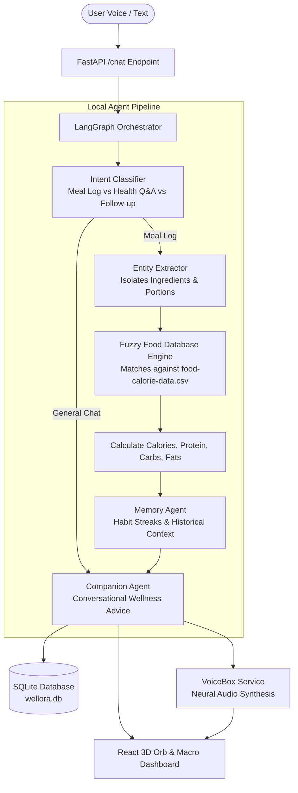

# 🌿 Wellora

> **Private, local-first AI nutrition companion with an interactive 3D voice orb.** Talk to Wellora naturally to log meals, track macros, and understand your diet without cloud surveillance.

<p align="center">
  
</p>

---

## Why Wellora?

Logging your food into traditional nutrition apps is tedious: you search clunky barcode databases, guess gram weights for home-cooked meals, and surrender your health data to third-party ad networks.

**Wellora** was built around three simple beliefs:
1. **Natural Dialogue:** You should be able to say *"I had two dosas with coconut chutney and a cup of filter coffee"* and have it broken down automatically into calories, protein, carbs, and fats.
2. **Local-First Privacy:** Powered by local LLMs via **Ollama** (e.g. Gemma or Llama 3) running on your own machine. Your intimate dietary habits remain strictly on your device.
3. **Immersive Physical Interface:** Instead of sterile spreadsheets, Wellora features an interactive **3D glowing voice orb** (built with Three.js) that responds to conversational states in real time.

---

## 🧠 Nutrition Intelligence Pipeline

Wellora's backend runs on **FastAPI** and **LangGraph**, routing queries through an asynchronous multi-agent pipeline:



### How Food Parsing Works
- **Zero-Guesswork Entity Extraction:** The extractor decomposes complex meals into atomic items (e.g., separating cooked rice, dal, vegetables, and ghee).
- **Fuzzy Nutritional Dataset Matching:** Rather than hallucinating calorie numbers, `food_db.py` matches items against curated datasets (`food-calorie-data.csv` and grouped nutritional libraries) to retrieve grounded macronutrient data.
- **Empathetic Companion Tone:** Provides constructive nutritional insights without guilt, lecturing, or clinical jargon.

---

## 🛠️ Tech Stack

| Layer | Technology | Details |
| :--- | :--- | :--- |
| **Local LLM Runtime** | [Ollama](https://ollama.com/) | Offline local model inference (Gemma / Llama) |
| **Agent Framework** | [LangGraph](https://langchain-ai.github.io/langgraph/) & [LangChain](https://www.langchain.com/) | Stateful multi-agent conversation graph |
| **Backend API** | [FastAPI](https://fastapi.tiangolo.com/) (Python 3.10+) | Asynchronous REST endpoints & audio streaming |
| **Database** | SQLite + [SQLAlchemy](https://www.sqlalchemy.org/) | Local storage for meals, user profiles, and daily goals |
| **Frontend UI** | [React](https://react.dev/) + [Vite](https://vite.dev/) | Ultra-responsive client with custom glassmorphism |
| **3D Voice Visualizer**| [Three.js](https://threejs.org/) | Vertex-displaced glowing orb with fluid audio reactivity |
| **State Management** | [Zustand](https://github.com/pmndrs/zustand) | Client store for chat messages, audio, and metrics |

---

## 📁 Repository Structure

```text
Wellora/
├── assets/                       # Visual preview & branding
│   ├── preview.png
│   └── hero.png
├── backend/                      # Python FastAPI server
│   ├── agents/                   # LangGraph agent pipeline
│   │   ├── orchestrator.py       # Main state machine & pipeline flow
│   │   ├── classifier.py         # Intent classification
│   │   ├── extractor.py          # Food entity & quantity extractor
│   │   ├── food_db.py            # CSV nutritional lookup & fuzzy matcher
│   │   ├── memory.py             # Historical context & habit streaks
│   │   ├── companion.py          # Empathetic conversational generator
│   │   └── voicebox_service.py   # Spoken audio generation
│   ├── data/                     # Verified nutritional datasets
│   │   └── food-calorie-data.csv # Food calories, protein, carbs & fats
│   ├── routers/
│   │   ├── chat.py               # Conversational & meal logging API
│   │   ├── dashboard.py          # Calorie totals & macro analytics
│   │   └── users.py              # User profiles & dietary goals
│   ├── database.py               # SQLite session setup
│   ├── models.py                 # SQLAlchemy schemas
│   ├── main.py                   # FastAPI server entry point
│   └── requirements.txt
├── frontend/                     # React + Vite application
│   ├── src/
│   │   ├── components/
│   │   │   ├── ThreeOrb.jsx      # Interactive 3D reactive voice sphere
│   │   │   ├── Navbar.jsx        # Navigation header
│   │   │   └── SmoothScroll.jsx  # Fluid momentum scrolling
│   │   ├── pages/
│   │   │   ├── Landing.jsx       # Welcome showcase
│   │   │   ├── Chat.jsx          # Voice & conversational logging
│   │   │   └── Dashboard.jsx     # Calorie rings, macros & meal history
│   │   ├── store/
│   │   │   └── useStore.js       # Zustand state management
│   │   ├── App.jsx
│   │   └── index.css
│   ├── package.json
│   └── vite.config.js
└── README.md
```

---

## 🚀 Getting Started

### 1. Prerequisites
- **Python 3.10+**
- **Node.js 18+**
- [Ollama](https://ollama.com/) installed and running locally

Pull your model of choice via Ollama:
```bash
ollama run gemma2
# or: ollama run llama3
```

### 2. Clone the Repository
```bash
git clone https://github.com/itsgoksz/wellora.git
cd wellora
```

### 3. Backend Setup
```bash
cd backend
python3 -m venv venv
source venv/bin/activate
pip install -r requirements.txt
```

Start the FastAPI backend:
```bash
uvicorn main:app --reload --port 8000
```

### 4. Frontend Setup
In a new terminal:
```bash
cd frontend
npm install
npm run dev
```
Open [http://localhost:5173](http://localhost:5173) in your browser to interact with the 3D Orb and start logging meals.

---

<p align="center">
  Crafted with care by <a href="https://github.com/itsgoksz">itsgoksz</a>
</p>
