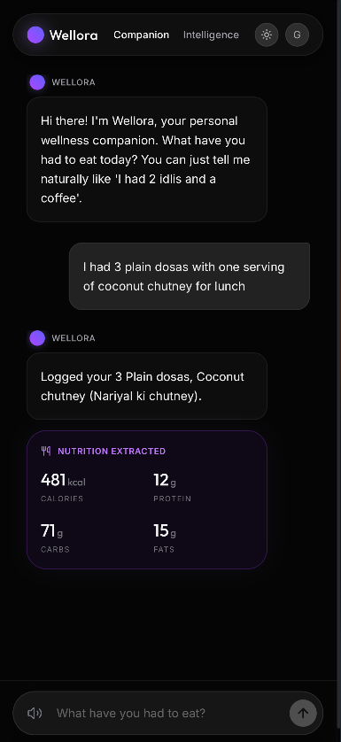
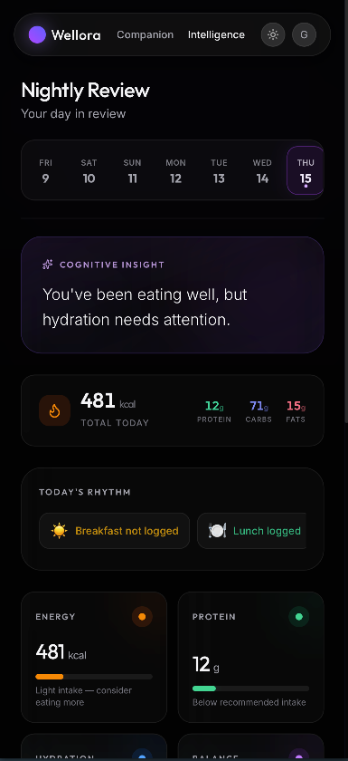
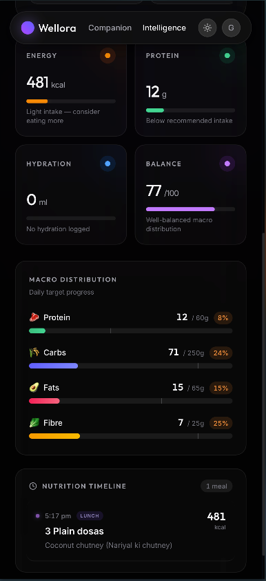
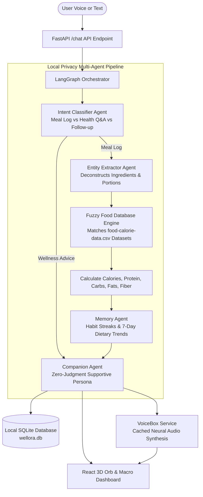

# Wellora

> Private, local-first AI nutrition companion with an interactive 3D voice orb. Speak your meals naturally in plain language; Wellora decomposes ingredients, estimates portions, and tracks macronutrients via offline local LLMs without cloud surveillance.

<p align="center">
  
</p>

---

## Why Wellora?

Logging food in mainstream fitness apps feels like data entry punishment:
- You spend 10 minutes scanning barcodes, guessing gram weights for home-cooked Indian dishes, and manually entering oil spoons.
- Commercial apps monetize your health data, packaging your diet logs for advertising networks.
- Rigid calorie goals turn nutrition into an anxiety-inducing spreadsheet instead of a sustainable, healthy habit.

**Wellora makes food tracking effortless through four core principles:**
1. **Effortless Voice-First Meal Logging:** Instead of typing numbers into rigid forms or scanning barcodes, simply speak out loud: *"I had 3 plain dosas with one serving of coconut chutney for lunch"*. Wellora captures speech in real time, parses regional Indian recipes, and breaks the meal down into exact calories and macros.
2. **Synchronized Chat & Dual-Modality:** Spoken food logs are transcribed instantly into the chat interface with an immediate visual nutrition card (calories, protein, carbs, fats). You can log completely through voice hands-free, or seamlessly type into the chat prompt whenever preferred.
3. **Local-First Privacy:** Powered by local open-weight LLMs via **Ollama** (Gemma 2 or Llama 3) running directly on your machine. Your dietary habits and health logs never leave your device.
4. **Zero Hallucinated Nutrition:** Rather than letting the LLM guess numbers, Wellora matches parsed ingredients against verified nutritional datasets (`food-calorie-data.csv`) using fuzzy matching to ensure grounded macro accuracy.

---

## Conversational Logging & Dietary Intelligence

### 1. Hands-Free Voice Meal Logging
Log meals naturally in plain English or regional terms. Wellora automatically transcribes your voice, identifies portion sizes, and presents an instant nutritional summary.

<p align="center">
  
</p>

### 2. Nightly Review & Cognitive Insights
At the end of each day, Wellora synthesizes your eating rhythm against weekly habits, offering supportive cognitive insights without clinical guilt.

<p align="center">
  
</p>

### 3. Macro Distribution & Nutrition Timeline
Track progress against daily dietary targets with macro progress bars (Protein, Carbs, Fats, Fibre), overall balance scores, and chronological meal timelines.

<p align="center">
  
</p>

---

## Nutrition Intelligence Pipeline

Wellora's architecture combines **FastAPI**, **LangGraph**, and **Ollama** into an asynchronous stateful pipeline:



### The Multi-Agent Suite
- **Intent Classifier (`classifier.py`):** Automatically distinguishes whether the user is logging breakfast, asking a nutritional question (*"Is curd rice good after a workout?"*), or clarifying a previous entry.
- **Entity Extractor (`extractor.py`):** Parses unformatted speech into structured JSON containing individual dishes, modifiers, and estimated portion sizes.
- **Fuzzy Food Matcher (`food_db.py`):** Runs `difflib.get_close_matches` against verified CSV datasets to map food names to authentic nutritional values.
- **Supportive Companion (`companion.py`):** Offers constructive nutritional context and streak encouragement without clinical guilt or scolding.
- **Interactive Three.js Orb (`ThreeOrb.jsx`):** A custom WebGL vertex-displaced particle sphere with dynamic shaders that morph through idle, listening, thinking, and speaking states.

---

## Tech Stack

| Layer | Technology | Description |
| :--- | :--- | :--- |
| **Local LLM Engine** | [Ollama](https://ollama.com/) (Gemma 2 / Llama 3) | 100% offline local model inference |
| **Agent Framework** | [LangGraph](https://langchain-ai.github.io/langgraph/) & [LangChain](https://www.langchain.com/) | Stateful multi-agent conversation graph |
| **Backend API** | [FastAPI](https://fastapi.tiangolo.com/) (Python 3.10+) | High-performance asynchronous API server |
| **Database** | SQLite + [SQLAlchemy](https://www.sqlalchemy.org/) | Local storage for meals, user profiles, and daily goals |
| **Frontend UI** | [React](https://react.dev/) + [Vite](https://vite.dev/) | Smooth responsive interface with glassmorphism |
| **3D Voice Visualizer**| [Three.js](https://threejs.org/) | Dynamic glowing particle orb with audio-reactive shaders |
| **State Store** | [Zustand](https://github.com/pmndrs/zustand) | Client-side reactive store for audio, chat & metrics |

---

## Repository Structure

```text
Wellora/
├── assets/                       # Branding & showcase captures
│   ├── preview.png               # Conversational voice logging & nutrition card
│   ├── review_preview.png        # Nightly review & cognitive health insights
│   ├── analytics_preview.png     # Macro distribution & nutrition timeline
├── backend/                      # Python FastAPI server
│   ├── agents/                   # LangGraph agent pipeline
│   │   ├── orchestrator.py       # Main state machine & pipeline flow
│   │   ├── classifier.py         # Conversational intent classifier
│   │   ├── extractor.py          # Food entity & quantity extractor
│   │   ├── food_db.py            # CSV nutritional lookup & fuzzy matcher
│   │   ├── memory.py             # Historical context & habit streaks
│   │   ├── companion.py          # Empathetic conversational generator
│   │   └── voicebox_service.py   # Spoken audio generation
│   ├── data/                     # Verified nutritional datasets
│   │   └── food-calorie-data.csv # Food calories, protein, carbs & fats
│   ├── routers/
│   │   ├── chat.py               # Conversational & meal logging API
│   │   ├── dashboard.py          # Daily totals & macro analytics
│   │   └── users.py              # User profiles & dietary goals
│   ├── database.py               # SQLite session setup
│   ├── models.py                 # SQLAlchemy schemas
│   ├── main.py                   # FastAPI server entry point
│   └── requirements.txt
├── frontend/                     # React + Vite application
│   ├── src/
│   │   ├── components/
│   │   │   ├── ThreeOrb.jsx      # Interactive 3D reactive voice sphere
│   │   │   ├── Navbar.jsx        # Navigation header
│   │   │   └── SmoothScroll.jsx  # Fluid momentum scrolling
│   │   ├── pages/
│   │   │   ├── Landing.jsx       # Welcome showcase
│   │   │   ├── Chat.jsx          # Voice & conversational logging
│   │   │   └── Dashboard.jsx     # Calorie rings, macros & meal history
│   │   ├── store/
│   │   │   └── useStore.js       # Zustand state management
│   │   ├── App.jsx
│   │   └── index.css
│   ├── package.json
│   └── vite.config.js
└── README.md
```

---

## Getting Started

### 1. Prerequisites
- **Python 3.10+**
- **Node.js 18+**
- [Ollama](https://ollama.com/) running locally

Pull the local model:
```bash
ollama run gemma2
# or: ollama run llama3
```

### 2. Clone the Repository
```bash
git clone https://github.com/itsgoksz/wellora.git
cd wellora
```

### 3. Backend Setup
```bash
cd backend
python3 -m venv venv
source venv/bin/activate
pip install -r requirements.txt
```

Start the FastAPI backend:
```bash
uvicorn main:app --reload --port 8000
```

### 4. Frontend Setup
In a new terminal window:
```bash
cd frontend
npm install
npm run dev
```
Open [http://localhost:5173](http://localhost:5173) to interact with the 3D Orb and log your first meal.

---

<p align="center">
  Crafted for health and privacy by <a href="https://github.com/itsgoksz">itsgoksz</a>
</p>
